# Wireshark Packet Capture and Traffic Analysis: A Beginner's Walkthrough

**Repository Description:** Beginner-friendly, step-by-step Wireshark lab documenting how to capture live network traffic, analyse DNS packets, identify IP addresses, and examine TLS handshakes using practical examples.

---

## Introduction

As part of my cybersecurity internship with **Network Walks**, I had the opportunity to practise capturing and analysing network traffic using Wireshark.

The goal of this lab was to understand what happens behind the scenes when we visit a website. We often type a website address into our browser and expect it to load, but several things happen in the background before that page appears.

For this exercise, I used **Wireshark to capture my laptop's network traffic while visiting `networkwalks.com`**. I then examined the captured packets to retrieve specific networking information.

By the end of this exercise, I was expected to find answers to the following six questions:

### Questions to Answer

1. What is the IP address of my laptop?
2. What is the IP address of my DNS server?
3. What is the IP address of the website `networkwalks.com`?
4. Which website name (Server Name) is sent in the TLS Client Hello?
5. Which server port is used for the secure connection?
6. Which TLS version does the website use?

To answer these questions, I had to capture live network traffic, apply Wireshark display filters and examine specific packet details.

This walkthrough takes you through how I completed the exercise, step by step, including what I was looking for, the challenges I encountered and how I resolved them.

---

## 1. Tools and Requirements

Before starting, these were the things I needed:

- A Windows laptop.
- An active internet connection.
- Google Chrome browser.
- Wireshark.
- Command Prompt.

### What is Wireshark?

Wireshark is a free network analysis tool that allows us to capture and examine packets travelling across a network.

Think of it as a tool that lets us look behind the scenes of network communication. Instead of just seeing that a website has loaded, we can examine some of the communication that took place between our device and other servers.

In this lab, I used Wireshark to observe DNS queries and TLS handshakes.

## 2. Installing Wireshark

The first thing I did was download Wireshark.

1. Visit the official download page: [Wireshark Download](https://www.wireshark.org/download.html).
2. Select the version suitable for your operating system.
3. Download and install it.
4. Follow the installation instructions until the setup is complete.

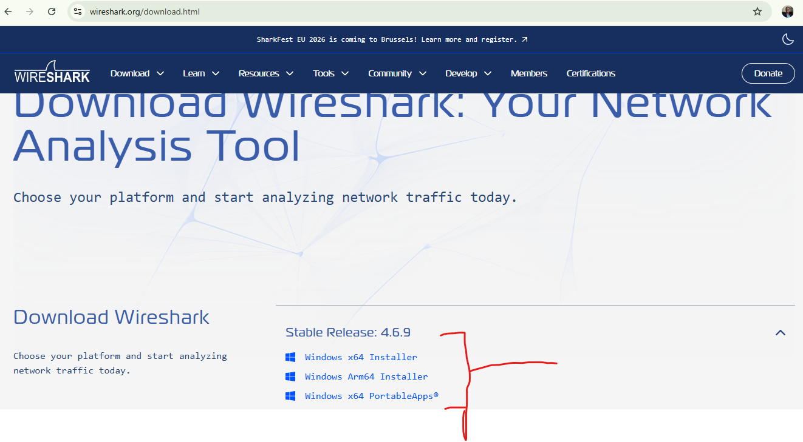

Once installed, open Wireshark. You should see a list of available network interfaces, such as Wi-Fi and Ethernet.

For this exercise, I used Wi-Fi because that was the network connection my laptop was using.

## 3. Clearing the DNS Cache

Before capturing any packets, I needed to clear the DNS cache on my laptop.

### What is DNS?

DNS stands for **Domain Name System**.

It works like a phonebook for the internet. When we type a website name such as `networkwalks.com`, our device needs to find the IP address associated with that name before it can connect to the website.

Sometimes, our computer remembers the IP address of a website we have visited before. This information is stored in the DNS cache.

For this exercise, I wanted my laptop to perform a fresh DNS lookup so I could capture and examine the DNS query.

### Step 1: Open Command Prompt

1. Close all browser windows.
2. Press the Windows key on your keyboard.
3. Search for **Command Prompt** or `cmd`.
4. Right-click it and select **Run as administrator**.
5. If Windows asks for permission, allow it.

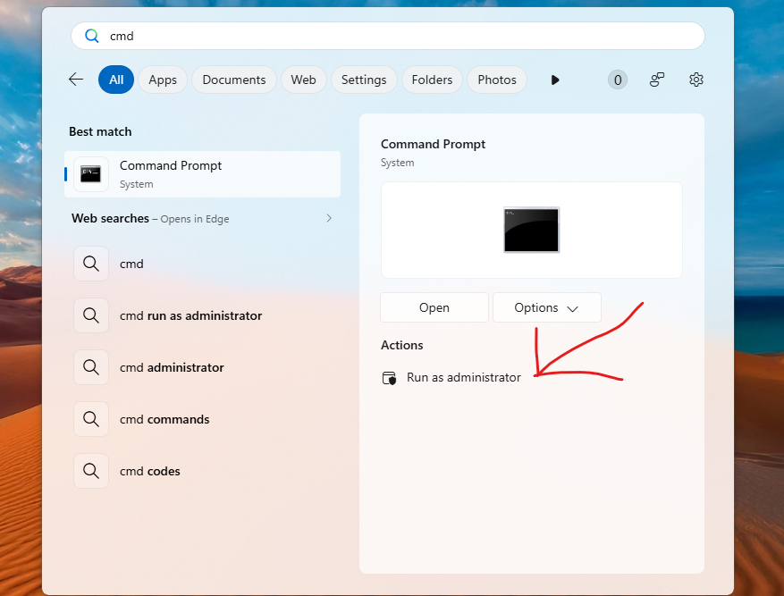

### Step 2: Flush the DNS cache

Type the following command:

```bash
ipconfig /flushdns
```

Press Enter.

You should see a message confirming that the DNS Resolver Cache was successfully flushed.

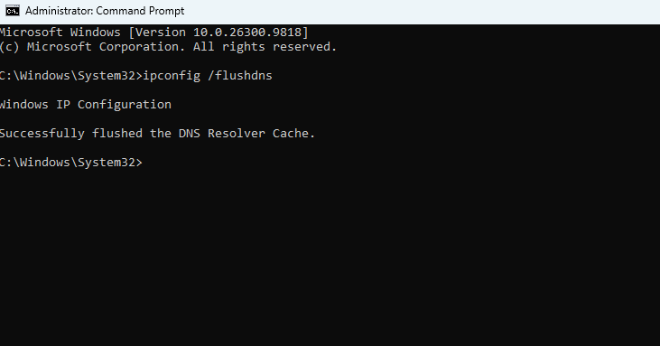

This means the stored DNS records have been cleared, allowing the device to perform a fresh lookup when we visit the website.

### ***Challenge I encountered: Command Prompt required elevation***

When I first entered the command, I received this message:

```text
The requested operation requires elevation.
```

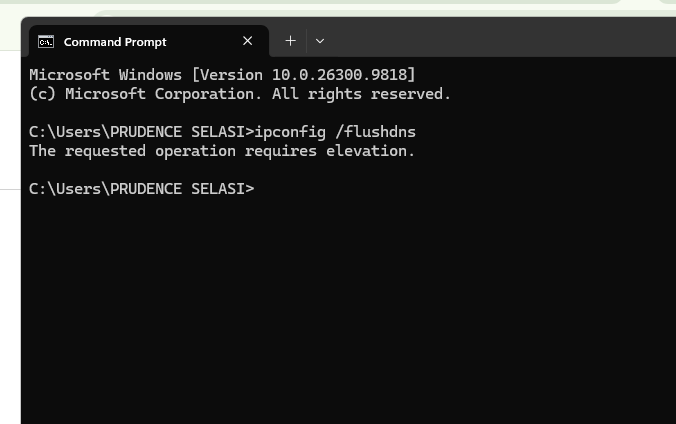

At first, I wasn't sure what the problem was. After looking into it, I understood that the command needed administrator privileges.

**How I resolved it:**

I closed the Command Prompt window, searched for CMD again, and selected **Run as administrator** before entering the command.


That solved the problem.

**Lesson learned:** Some commands require administrator permissions to run successfully. When you encounter an elevation error, check whether you need to open your terminal as an administrator.

## 4. Capturing Live Network Traffic

Now that the DNS cache was cleared, I was ready to capture network traffic.

### Step 1: Start Wireshark

1. Open Wireshark.
2. Look for the available network interfaces on the home screen.
3. Find the interface you are currently using. In my case, it was Wi-Fi.
4. Double-click the Wi-Fi interface to start capturing packets.

You should begin seeing packets appear on the screen.

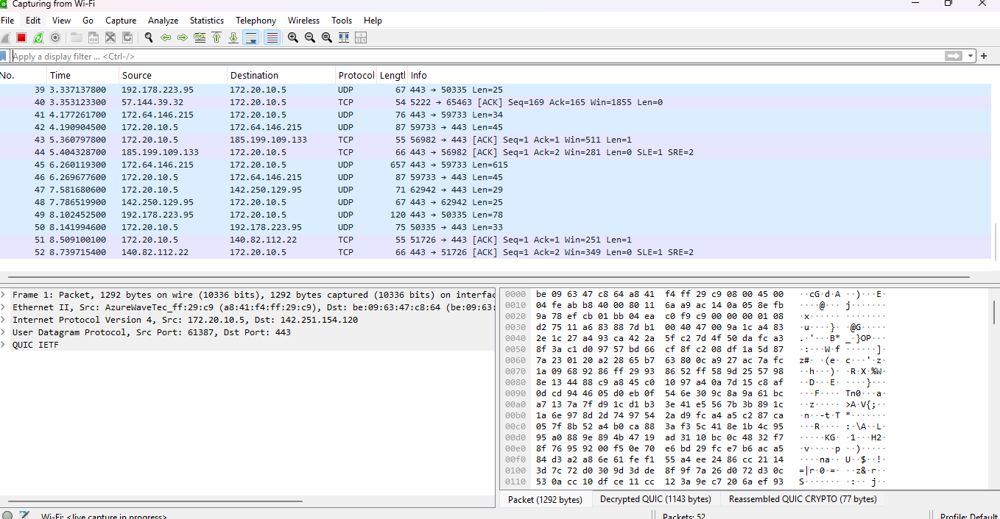

These are examples of network communication happening through your device.

### Step 2: Visit the website

While Wireshark was capturing traffic:

1. Open Google Chrome.
2. Open a Guest profile or a new Incognito window.
3. Visit [https://networkwalks.com](https://networkwalks.com/).
4. Wait for the website to load completely.

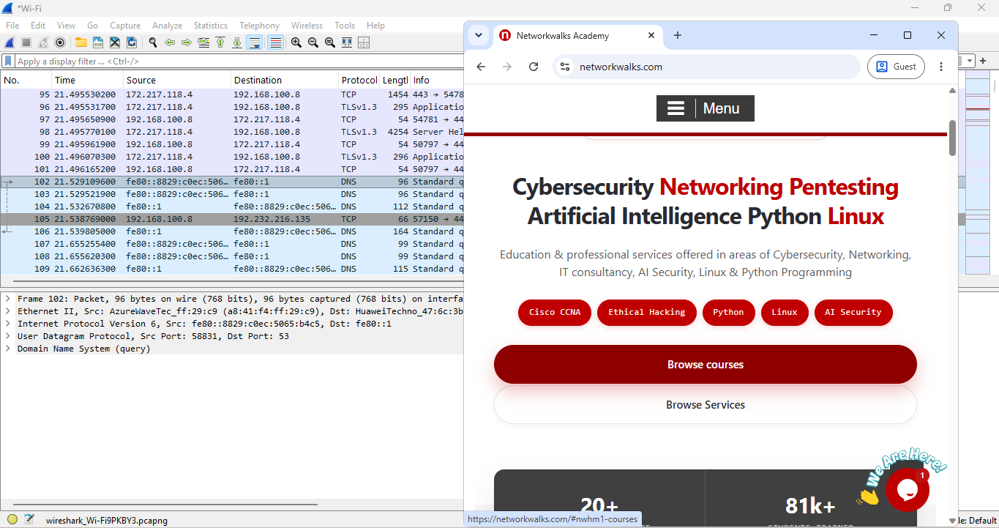

I used a separate browser session to carry out the exercise.

### Step 3: Stop the capture

After the website had loaded:

1. Return to Wireshark.
2. Click the red square **Stop** button at the top-left corner.

This stops the live capture and allows you to examine the packets that have already been collected.

> **Important:** Wireshark may capture many packets while you browse. That is normal. We will use display filters to find the specific packets we need.

## 5. Analysing DNS Packets

The next step was to identify the DNS query generated when I visited `networkwalks.com`.

### What is a DNS query?

A DNS query is simply a request sent by your device asking a DNS server to find the IP address associated with a particular website name.

In this exercise, I wanted to find two things:

- The IP address of my laptop.
- The IP address of the DNS server my laptop contacted.

### Step 1: Apply the DNS display filter

At the top of Wireshark, locate the display filter bar.

Enter:

```wireshark
dns.qry.name == "networkwalks.com"
```
Press Enter.

This filter tells Wireshark to show DNS packets relating to the website `networkwalks.com`.

You should see the DNS query and its corresponding response, provided the query was captured successfully.

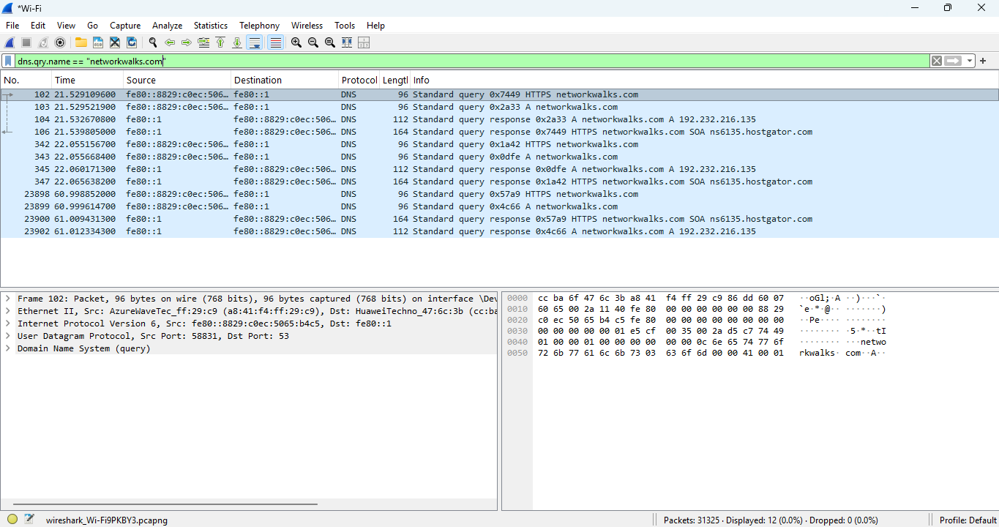

### Step 2: Identify the source and destination IP addresses

Click on the DNS query packet.

Look at the packet details in the middle pane.

Here is how I understood the information:

- **Source:** The IP address of the device that sent the DNS request. In this exercise, it is my laptop.
- **Destination:** The IP address of the DNS server receiving the request.

So, the source tells us where the request came from, while the destination tells us where it was going.

These gave me the answers to the first two questions in the lab.

### Question 1: What is the IP address of my laptop?

**Answer:** The Source IP address in the DNS query packet.

### Question 2: What is the IP address of my DNS server?

**Answer:** The Destination IP address in the DNS query packet.

> **Note:** These IP addresses depend on your own network. Do not copy someone else's results.

### ***Challenge I encountered: My display filter was not working***

When I first entered the display filter, I omitted some letters. As a result, Wireshark did not return the results I was expecting.

**How I resolved it:**

I went back to the filter bar, checked the spelling carefully and corrected the command.

**Lesson learned:** Display filters need to be accurate. Even a small spelling mistake can prevent Wireshark from showing the information you are looking for.

## 6. Finding the Website's IP Address

After identifying the laptop and DNS server IP addresses, I moved on to finding the IP address of `networkwalks.com`.

Remember, the DNS server is responsible for providing the IP address associated with the website name.

### Steps I followed

1. Keep the DNS filter applied.
2. Locate the DNS response packet.
3. Click on the response packet.
4. In the middle pane, look for **Domain Name System (response)**.
5. Click the arrow beside it to expand the details.
6. Find and expand **Answers**.
7. Look for the field labelled **Address** or `addr`.

The IP address displayed there is the IP address returned for the website.

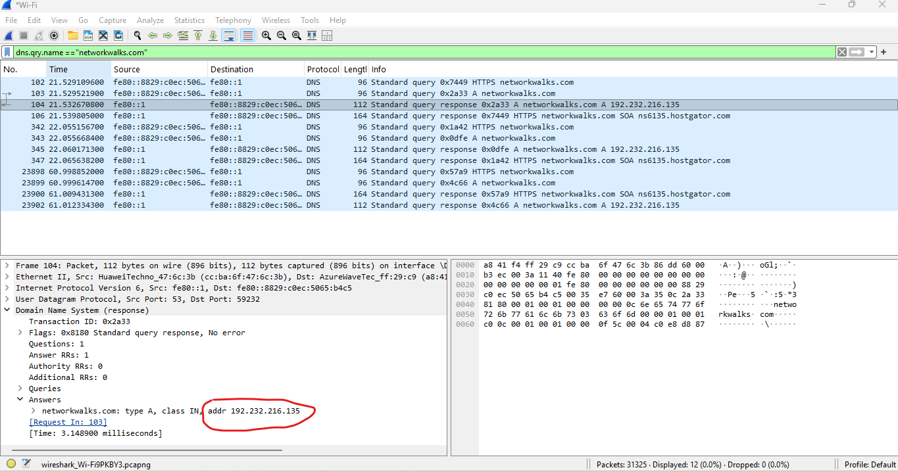

### Question 3: What is the IP address of networkwalks.com?

**Answer:** The IP address shown under the DNS response's Answers section.

This was how I identified the website's IP address without having to guess or look it up separately.

### ***What if no DNS packets appear?***

If you entered the correct DNS filter but no packets appeared.

**1. Close the browser completely.**

Make sure all browser windows are closed.

**2. Flush the DNS cache again.**

Open Command Prompt as administrator and run:

```bash
ipconfig /flushdns
```

**3. Check Chrome's Secure DNS setting.**

Chrome has a Secure DNS feature that can affect the DNS traffic visible during this exercise.

To check it:

1. Open Chrome.
2. Go to **Settings**.
3. Select **Privacy and security**.
4. Select **Security**.
5. Find the **Use secure DNS** option.
6. Turn it off temporarily for this practice if necessary.

> **Remember:** Turn Secure DNS back on after the exercise if you normally use it.

**4. Repeat the capture.**

Return to Wireshark, start a fresh capture, visit the website and stop the capture after the page loads.

Then apply the DNS display filter again.

## 7. Finding the Server Name in the TLS Client Hello

After completing the DNS analysis, I moved on to the TLS handshake.

### First, what is TLS?

TLS stands for **Transport Layer Security**.

It is a security protocol that helps protect communication between a user's device and a website.

For example, when you visit a website that uses HTTPS, TLS helps establish a secure connection between your browser and the website's server.

Before this secure communication begins, the client (your browser) and the server exchange some information. This process is called a **TLS handshake**.

One of the first messages sent by the client is called the **Client Hello**.

### Step 1: Apply the Client Hello filter

In Wireshark's display filter bar, enter:

```wireshark
tls.handshake.type == 1
```

Press Enter.

This filter displays TLS Client Hello packets.

### Step 2: Find the correct packet

Look through the results for the Client Hello packet associated with `networkwalks.com`.

### Step 3: Find the Server Name

1. Click the relevant Client Hello packet.
2. Go to the middle packet details pane.
3. Expand **Transport Layer Security**.
4. Expand the **Handshake Protocol: Client Hello** section.
5. Find and expand **Extension: server_name**.
6. Expand the **Server Name Indication extension**.

You should find the website name displayed there.

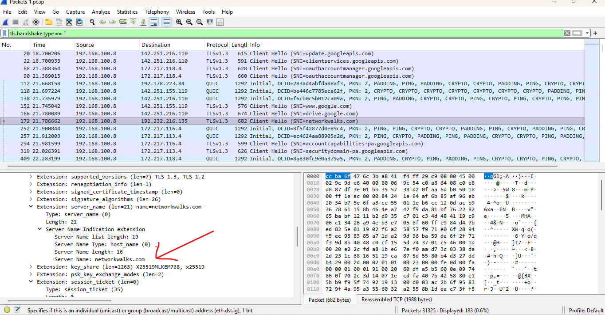

### Question 4: Which website name (Server Name) is sent in the TLS Client Hello?

**Answer:** `networkwalks.com`

### What is SNI?

SNI stands for **Server Name Indication**.

It is an extension used during the TLS handshake that allows a client to indicate the hostname of the server it wants to connect to.

In simple terms, it helps identify the website the browser is trying to reach.

## 8. Finding the Server Port

While examining the Client Hello packet, I also needed to identify the port used by the website's secure connection.

### What is a port?

Think of an IP address as the address of a building and a port as the particular entrance used to reach a service inside that building.

Different network services use different port numbers.

For example, HTTPS commonly uses port **443**.

### Steps I followed

1. Select the relevant Client Hello packet.
2. In the middle details pane, find **Transmission Control Protocol (TCP)**.
3. Expand the TCP section.
4. Look for **Destination Port**.

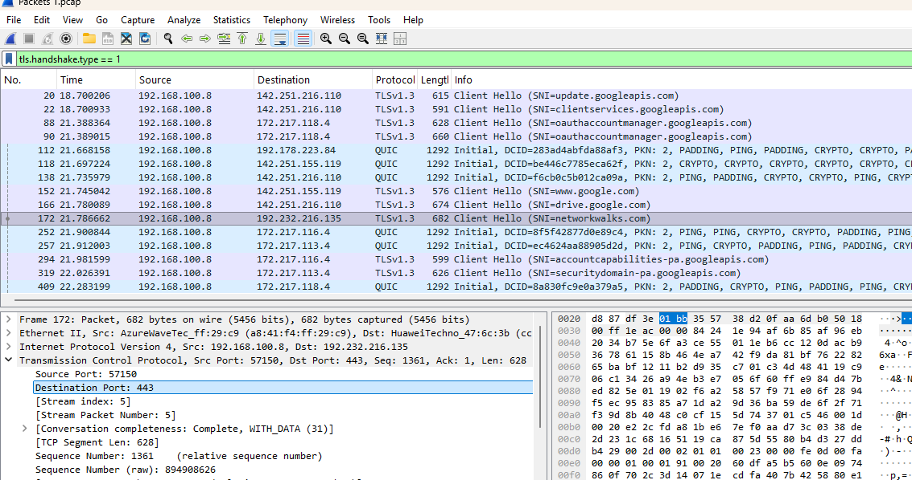


For a normal HTTPS connection, you will commonly find:

### Question 5: Which server port is used for the secure connection?

**Answer:** `443`

This is the standard port used for HTTPS.


## 9. Finding the TLS Version

The final task was to identify the TLS version used by the website.

For this, I needed to examine the Server Hello packet.

### What is Server Hello?

During the TLS handshake, the server responds to the client's Client Hello message with a message called **Server Hello**.

It contains information about the connection parameters agreed upon by the client and server.

### Step 1: Apply the Server Hello filter

Go to the Wireshark display filter bar and enter:

```wireshark
tls.handshake.type == 2
```

Press Enter.

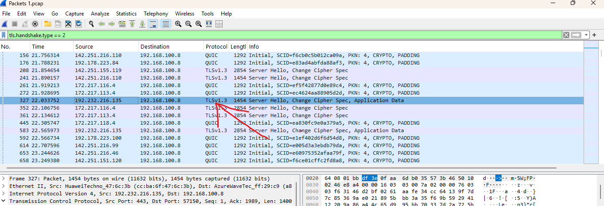

This filter displays TLS Server Hello packets.

### Step 2: Identify the correct packet

Look through the results and find the Server Hello packet where the Source IP address matches the website's IP address you identified earlier.

### Step 3: Check the protocol

Look at the **Protocol** column in Wireshark.

The TLS version displayed there gives you the answer to the final question in this lab.

### Question 6: Which TLS version does the website use?

**Answer:** The TLS version displayed for the relevant Server Hello packet.

For the example provided in the Network Walks lab guide, the answer was **TLSv1.3**.

> **Important:** Your actual result should be based on the packet you captured.


## 10. Summary of the Wireshark Filters Used

These are the display filters I used throughout the exercise. I have put them together in one table for easy reference.

| Purpose | Wireshark Display Filter |
|---|---|
| Find DNS packets for the website | `dns.qry.name == "networkwalks.com"` |
| Find TLS Client Hello packets | `tls.handshake.type == 1` |
| Find TLS Server Hello packets | `tls.handshake.type == 2` |

## 11. What I Learned From This Exercise

This practical exercise helped me understand some networking concepts beyond just reading about them.

Here are my main takeaways:

1. **DNS is important:** I learned how a device uses DNS to find the IP address of a website before connecting to it.
2. **Packets contain useful information:** Using Wireshark, I could examine the source and destination IP addresses of network communication.
3. **Display filters make analysis easier:** Instead of going through hundreds or thousands of packets individually, I could use specific filters to find the information I needed.
4. **TLS helps secure website communication:** I learned how the Client Hello and Server Hello messages are involved in establishing a secure connection.
5. **Details matter:** My experience with the incorrect display filter reminded me that small mistakes can affect the results of a technical task.
6. **Troubleshooting is part of learning:** I initially encountered problems with administrator permissions and missing DNS packets. Working through these issues helped me understand the process better.

## 12. Final Thoughts

One thing I appreciated about this lab was that I got to see some of the networking activities that normally happen in the background whenever we visit a website.

Before this exercise, I knew that websites used IP addresses and that HTTPS helped secure communication. However, being able to capture the traffic and identify these details myself made the concepts easier to understand.

I am still learning, but this exercise gave me a better understanding of how DNS, IP addresses, ports and TLS work together during a website connection.

This is one of my practical learning exercises as I continue building my knowledge and hands-on experience in cybersecurity.

---

## References

- [Wireshark Official Website](https://www.wireshark.org/)
- [Network Walks](https://networkwalks.com/)

**Training:** Network Walks Cybersecurity Internship

**Lab:** Wireshark Packet Capture

**Focus Areas:** Network Traffic Capture, DNS Analysis, IP Address Identification and TLS Handshake Analysis.
